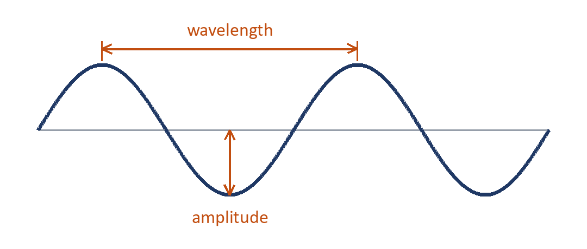

# Homework 1, Week 1: how sound travels
**Set:** Monday 7 September · **Due:** Friday 11 September at 08:00

Read the card below, then answer in the amber boxes on this page. It should take about 20 minutes.

> [!abstract] This week's reading: Sound waves
> Read only these sections, and leave the rest for next week:
>
> - [ ] What makes a sound
> - [ ] How sound moves through air
> - [ ] Wavelength and amplitude
>
> Stuck on a word?\
> Look it up in the Key words below.

## Key words

| Word | What it means | Where you meet it |
| --- | --- | --- |
| **Vibration** | Something moving quickly back and forth | A guitar string, your vocal cords |
| **Compression** | Air pushed closer together | Right in front of a loudspeaker |
| **Amplitude** | How far the wave moves from the centre | Bigger means louder |

## Look at the picture

| Name it | Your answer |
| --- | --- |
| What does the wavelength measure? | |
| What happens to the amplitude when a sound gets louder? | |

## Explain it

| Explain why sound cannot travel through a vacuum. **(4 marks)** |
| --- |
| |
| |

## What is wrong?

> [!quote] A student wrote
> Sound travels fastest through air because air is the lightest.

| What is wrong | Put it right |
| --- | --- |
| | |

## True or false

Type x in the box.

| Statement | True | False |
| --- | --- | --- |
| Sound needs something to travel through. | ☐ | ☐ |
| A higher pitch means a longer wavelength. | ☐ | ☐ |
| A louder sound has a bigger amplitude. | ☐ | ☐ |

**Going further:** find out why you see lightning before you hear the thunder, and write one sentence on it.
